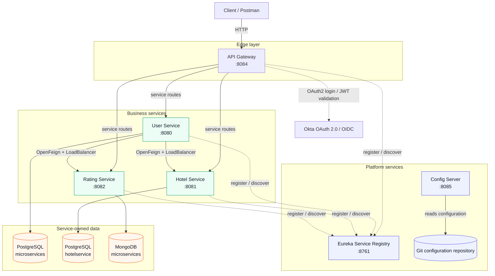
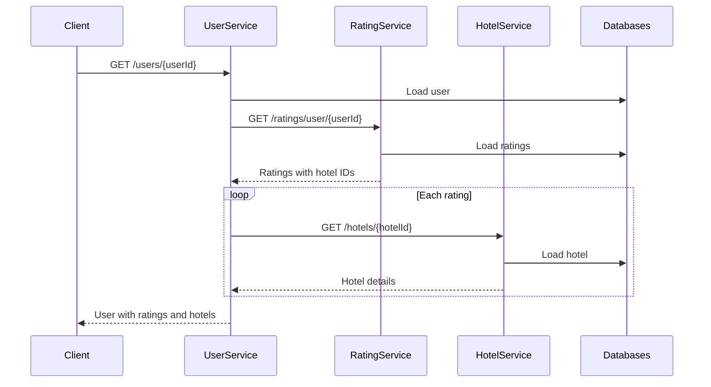

# Spring Cloud Microservices Platform

A production-oriented learning platform built with Spring Boot and Spring Cloud. The
application demonstrates service discovery, API routing, synchronous service-to-service
communication, polyglot persistence, OAuth 2.0 security, and resilience patterns.

> **Security:** Credentials are intentionally not stored in this repository. Configure
> secrets through environment variables or an ignored local configuration file.

## Architecture



### Request flow



## Services

| Service | Port | Role | Persistence |
|---|---:|---|---|
| `ServiceRegistry` | 8761 | Eureka server for registration and discovery | None |
| `UserService` | 8080 | User CRUD and aggregated user details | PostgreSQL |
| `HotelService` | 8081 | Hotel CRUD | PostgreSQL |
| `RatingService` | 8082 | Rating CRUD and user rating lookup | MongoDB |
| `ApiGateway` | 8084 | Load-balanced routing and OAuth 2.0 security | None |
| `ConfigServer` | 8085 | Spring Cloud Config server backed by Git | None |

The Eureka dashboard is available at `http://localhost:8761` when the registry is
running.

## Technology stack

- **Language/runtime:** Java 21
- **Framework:** Spring Boot 4.1.2
- **Cloud platform:** Spring Cloud 2025.1.4
- **Service discovery:** Netflix Eureka Server and Eureka Client
- **Edge routing:** Spring Cloud Gateway Server Web MVC
- **Service communication:** Spring Cloud OpenFeign and Spring Cloud LoadBalancer
- **Persistence:** Spring Data JPA with PostgreSQL; Spring Data MongoDB
- **Security:** Spring Security, OAuth 2.0 client, JWT resource server, and Okta
- **Resilience:** Resilience4j circuit breaker and rate limiter in `UserService`
- **Build:** Maven Wrapper per service
- **Utilities:** Lombok and Spring Boot Actuator
- **Testing:** Spring Boot test starters and service-level test suites

## Repository layout

```text
.
├── ApiGateway/       # Routes requests and handles OAuth 2.0
├── ConfigServer/      # Serves shared configuration from Git
├── HotelService/     # Hotel API backed by PostgreSQL
├── RatingService/    # Rating API backed by MongoDB
├── ServiceRegistry/  # Eureka discovery server
├── UserService/      # User API and aggregation layer
└── README.md
```

Each service is an independent Maven application with its own wrapper, `pom.xml`,
application configuration, source code, and tests.

## Prerequisites

- Java 21 or later
- PostgreSQL with databases `microservices` and `hotelservice`
- MongoDB with database `microservices`
- An Okta OIDC application if using the secured gateway
- Git credentials configured if `ConfigServer` reads a private configuration repository

Do not commit passwords, tokens, private keys, or `.env` files. The tracked application
configuration uses environment-variable placeholders for sensitive values.

## Configuration

Set these variables in the shell that starts each service:

```powershell
# UserService
$env:USER_DB_USERNAME = "postgres"
$env:USER_DB_PASSWORD = "<user-database-password>"

# HotelService
$env:HOTEL_DB_USERNAME = "postgres"
$env:HOTEL_DB_PASSWORD = "<hotel-database-password>"

# ApiGateway
$env:OKTA_CLIENT_SECRET = "<okta-client-secret>"
```

The gateway also contains the non-secret Okta client ID and issuer URL. Replace those
values with the settings from your own Okta tenant when deploying this project.

## Running locally

This repository is organized so each service can be started independently. Start them
in this order:

1. `ServiceRegistry`
2. `HotelService`
3. `RatingService`
4. `UserService`
5. `ApiGateway` (optional)
6. `ConfigServer` (optional, for centralized configuration)

From a separate PowerShell window for each service:

```powershell
cd C:\path\to\Microservices\ServiceRegistry
.\mvnw.cmd spring-boot:run
```

Repeat with the other service directories. This README documents the commands but does
not start any service automatically.

## API examples

Create a user:

```http
POST http://localhost:8080/users
Content-Type: application/json

{
  "name": "Jignesh",
  "email": "jignesh@example.com",
  "about": "Java Full Stack Developer"
}
```

Create a hotel:

```http
POST http://localhost:8081/hotels
Content-Type: application/json

{
  "name": "Moti Mahal",
  "location": "LKO",
  "about": "Very good food services."
}
```

Create a rating using the IDs returned by the previous requests:

```http
POST http://localhost:8082/ratings
Content-Type: application/json

{
  "userId": "<user-id>",
  "hotelId": "<hotel-id>",
  "rating": 8,
  "feedback": "Very good food and service."
}
```

Retrieve the aggregated user response:

```http
GET http://localhost:8080/users/<user-id>
```

Through the gateway, the equivalent routes are available on port `8084`:

```text
GET http://localhost:8084/users/<user-id>
GET http://localhost:8084/hotels/<hotel-id>
GET http://localhost:8084/ratings/user/<user-id>
```

## Git and secret-handling policy

The root `.gitignore` excludes Maven output, IDE metadata, local environment files,
logs, generated archives, and private key material. If a credential was ever exposed,
rotate it at the provider before using the repository again. Making a repository private
does not replace credential rotation.

## License

No license has been selected for this project yet. Add a license before distributing it
outside the project team.
